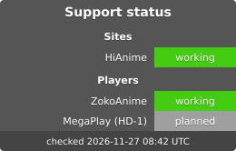

<div align="center">


# Tsundoku

**積ん読** · buying books and letting them pile up unread. Here: anime episodes.

A Firefox extension that downloads anime episodes from streaming sites as normal MP4 files,
one episode or a whole season at a time, with subtitles inside the video.

[](#supported-sites)
[](#supported-sites)
[](https://github.com/maniinpurple/Tsundoku/actions/workflows/ci.yml)
[](#install)

[Install](#install) · [Use it](#how-to-use) · [Supported sites](#supported-sites) · [FAQ](#faq) ·
[Contributing](CONTRIBUTING.md) · [How it works](docs/HOW-IT-WORKS.md)

</div>

---

## Features

- **Pick episodes, press Download.** Tick episodes, select all, or type a range like `1-12, 15`.
- **Plain MP4 files** that play everywhere: QuickTime, IINA, VLC, phones, TVs, Jellyfin, Plex.
- **Subtitles inside the video** as selectable tracks, in one language or every language the site has.
  Separate `.srt` files are available too (handy for Jellyfin and Plex).
- **Sub or Dub**, **quality** of your choice (falls back to the next lower one when an episode lacks it).
- **Queue** with 1–3 episodes at a time, progress, Cancel and Retry.
- **Resumes** where it stopped if Firefox unloads the extension or quits mid-download.
- **Remembers** which episodes you already have (✓) and skips them if you want.
- **Your own file names:** folder and file name template, e.g. `{anime}/{anime} - E{episode} [{quality}]`.
- **No ads, no tracking, no accounts.** Nothing is sent anywhere except to the sites the video comes from.

## Supported sites



**Sites** are where you browse anime. **Players** are the video players those sites embed (their "servers");
Tsundoku unlocks one player at a time, and a site works as long as one of its servers uses an unlocked player.

| Site | Notes |
|---|---|
| [HiAnime](https://hianime.fm) | Any `hianime.*` mirror. Episode lists, Sub and Dub |

| Player | Seen on | Notes |
|---|---|---|
| ZokoAnime | HiAnime "ZokoAnime" server | 360p–1080p, up to ~9 subtitle languages |
| MegaPlay | HiAnime "HD-1" server | Planned as a fallback |

The table on the right is checked against the real servers every 6 hours by
[a GitHub Action](.github/workflows/health.yml): **working** = it found episodes or a playable stream just now,
**broken** = the last check failed, **planned** = not supported yet. The *health* and *uptime 7d* badges at
the top summarise the same checks.

If something stops working, please [open an issue](https://github.com/maniinpurple/Tsundoku/issues/new/choose).

<br clear="right">

## Install

Tsundoku needs **Firefox 140 or newer** (desktop). A Chrome version is planned.

### Option A: signed release (recommended)

1. Download the latest `tsundoku-*.xpi` from [Releases](https://github.com/maniinpurple/Tsundoku/releases).
2. Open the file with Firefox (or drag it onto a Firefox window) and click **Add**.

### Option B: from source, for testing

```bash
git clone https://github.com/maniinpurple/Tsundoku.git
cd Tsundoku
npm install
npm run build
```

Then in Firefox open `about:debugging#/runtime/this-firefox`, click **Load Temporary Add-on…** and pick
`.output/firefox-mv3/manifest.json`. A temporary add-on is removed when Firefox quits.

More ways to install, and how to publish your own signed build, are in [docs/INSTALL-AND-PUBLISH.md](docs/INSTALL-AND-PUBLISH.md).

## How to use

1. Open an anime page on a supported site, e.g. `hianime.fm/frieren-beyond-journeys-end-481`.
2. Click the Tsundoku icon in the toolbar. If Firefox asks, allow access to websites.
3. Tick the episodes you want. The bar at the bottom sets **Sub/Dub**, **quality**, **subtitles** and **language**.
4. Press **Download N episodes**. Progress shows in the **Downloads** tab; you can close the popup.
5. Finished episodes have **Open** and **Folder** buttons.

Files go to your Downloads folder:

```
Downloads/
└── Tsundoku/
    └── Frieren Beyond Journey's End/
        ├── Frieren Beyond Journey's End - E01 [1080p] [Sub].mp4
        └── Frieren Beyond Journey's End - E02 [1080p] [Sub].mp4
```

### Settings (⚙ tab)

| Setting | Default | What it does |
|---|---|---|
| Folder | `Tsundoku` | Folder inside Downloads |
| File name | `{anime}/{anime} - E{episode} [{quality}] [{track}]` | Tokens: `{anime}` `{episode}` `{title}` `{quality}` `{track}`; `/` makes sub-folders |
| Episodes at the same time | 2 | 1–3. More is not faster: the video servers slow down busy clients |
| Skip episodes I already downloaded | on | Uses the ✓ history kept by the extension |
| Advanced | off | Shows each episode's stream and subtitle links with Copy buttons |

## FAQ

**I don't see subtitles in QuickTime.** QuickTime starts with subtitles off. Choose **View → Subtitles → English**
(or another language). IINA, VLC and Infuse show the default track on their own.

**Which subtitle mode should I pick?** *In the video* for watching on a computer or phone. *Separate .srt* (or *Both*)
if a media server like Jellyfin or Plex should pick them up.

**A download failed.** Press **Retry**: it continues from the last finished part. If it keeps failing, the site
or player probably changed; please [report it](https://github.com/maniinpurple/Tsundoku/issues/new/choose).

**How much disk space does it need?** A 24-minute episode is about 70 MB at 360p and 350–900 MB at 1080p.
While converting, Tsundoku briefly needs about twice the episode size free.

**Why does it need access to all websites?** Sites move between mirror domains and their video servers change
often, so a fixed list of domains would keep breaking. Tsundoku only contacts the site you are on, its video
players and their video servers.

**Does it bypass Cloudflare checks, CAPTCHAs or DRM?** No, and it never will. It downloads what the site's own
player streams to your browser.

## Development

```bash
npm install
npm run dev        # opens a fresh Firefox with the extension loaded; reloads on every save
npm run check      # type-check
npm run build      # build into .output/firefox-mv3
npm run lint       # Mozilla's add-on linter on the build
npm run zip        # extension zip + sources zip (for addons.mozilla.org)
npm run e2e        # downloads a real episode in a hidden Firefox and checks the result
npm run health     # checks every supported site and player, redraws status/status.svg
```

Set `FIREFOX_BIN` if `npm run dev` cannot find Firefox, for example
`FIREFOX_BIN="/Applications/Firefox Developer Edition.app/Contents/MacOS/firefox"`.

- [CONTRIBUTING.md](CONTRIBUTING.md): how to help, project layout, adding a site or a player.
- [docs/HOW-IT-WORKS.md](docs/HOW-IT-WORKS.md): how the sites and players work and how to investigate a new one.
- [ROADMAP.md](ROADMAP.md): milestones, findings and plans.

Built with [WXT](https://wxt.dev), React, TypeScript and [mux.js](https://github.com/videojs/mux.js).

## Disclaimer

Tsundoku is a tool for personal, offline viewing. It does not host, store or distribute any video. You are
responsible for respecting the laws of your country and the rights of content owners. If you can, support the
creators through official releases and legal streaming services.
